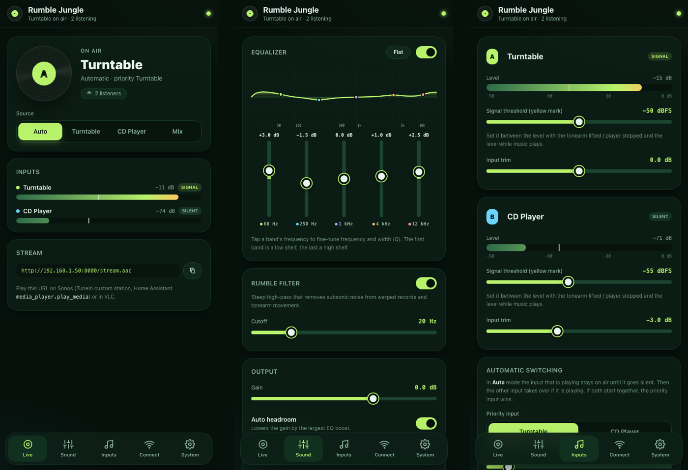
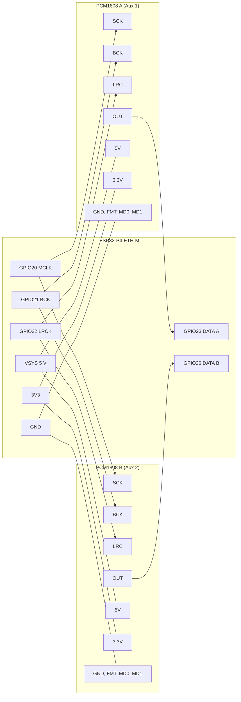
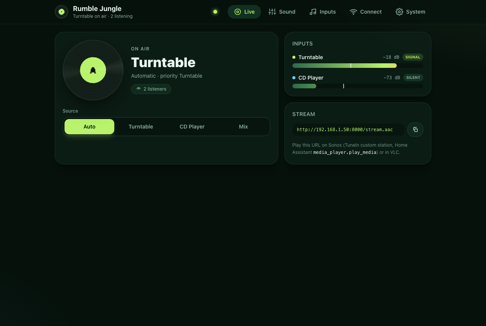

# Rumble Jungle


Stream two analog line-level sources (Aux 1 and Aux 2: a turntable via phono preamp, a cassette deck, a CD player, a tuner, ...) to Sonos and other network
players. An ESP32-P4 captures both inputs with two PCM1808 ADCs and automatically puts the one
that is playing on air. The audio passes a rumble filter and a parametric equalizer, is encoded to
AAC and served as an HTTP radio stream. A web UI and MQTT (with Home Assistant discovery) give
you control over everything.

```
Aux 1 (e.g. turntable + preamp) -> PCM1808 A --+
                                         +-> ESP32-P4: source select -> rumble filter -> EQ -> AAC
Aux 2 (e.g. cassette deck) -----> PCM1808 B --+                   |                                |
                                                    Web UI (port 80)              HTTP stream (port 8000)
                                                    MQTT -> Home Assistant        -> Sonos, VLC, ...
```

<p align="center">
  
</p>

> **Status:** runs on a Waveshare ESP32-P4-ETH (chip rev. 3.2): Ethernet, web UI, AAC stream with
> several listeners, live bitrate changes, MQTT with Home Assistant discovery, factory reset.
> Audio capture with real PCM1808 modules has not been verified yet. Feedback and fixes welcome.

## Features

- **Two inputs, one stream.** *Auto* puts whichever input is playing on air. You can also fix
  the source to A or B, or mix both. Switching cross-fades without clicks.
- **Active source everywhere.** The web UI, MQTT and Home Assistant all show which input is on
  air (by default `Aux 1` or `Aux 2`, renamable, plus `Mix` or `None`).
- **Sound shaping.** 4th-order rumble filter, 5-band parametric EQ with a live response curve,
  per-input trim, output gain, auto headroom and a soft limiter.
- **Web UI.** Phone-friendly single page app on port 80: live meters, equalizer, inputs,
  MQTT, network, firmware update. It is embedded in the firmware and needs no internet.
- **Home Assistant out of the box.** MQTT discovery creates a device with every setting and
  sensor. The broker connection can be changed at runtime.
- **Ethernet + PoE.** Fixed or DHCP address, `rumble-jungle.local` via mDNS.
- **OTA updates** from the web UI, with automatic rollback if the new firmware fails to start.

## Hardware

| Part | Notes |
|---|---|
| Waveshare **ESP32-P4-ETH-M** | ESP32-P4-ETH with the PoE module. Powered over PoE or USB-C. |
| 2 x **PCM1808** ADC module | Common low-cost I2S breakout, 24 bit / 44.1 kHz |
| Phono preamp | Only for a turntable without a built-in preamp (MM cartridge) |
| Jumper wires, RCA sockets | Keep the clock wires short |

The board has no Wi-Fi radio; the device connects over Ethernet only. The on-board ES8311 codec
is not used.

## Wiring

### Header pinout (Waveshare ESP32-P4-ETH)

The board has a 2 x 20 pin header (Raspberry Pi Pico layout). Pin 1 is next to the USB-C
connector. Pins marked **◀** are used by Rumble Jungle; all of them are on the right-hand row.

```
                   USB-C
              ┌────────────┐
    GPIO54  1 │ ●        ● │ 40 VBUS
    GPIO19  2 │ ●        ● │ 39 VSYS    ◀ 5 V for both ADCs
       GND  3 │ ●        ● │ 38 GND     ◀ ground for both ADCs
    GPIO18  4 │ ●        ● │ 37 3V3_EN  (leave open)
    GPIO17  5 │ ●        ● │ 36 3V3     ◀ 3.3 V for both ADCs
    GPIO16  6 │ ●        ● │ 35 GPIO20  ◀ MCLK   -> SCK of A and B
    GPIO15  7 │ ●        ● │ 34 GPIO21  ◀ BCK    -> BCK of A and B
       GND  8 │ ●        ● │ 33 GND
    GPIO14  9 │ ●        ● │ 32 GPIO22  ◀ LRCK   -> LRC of A and B
     GPIO6 10 │ ●        ● │ 31 GPIO23  ◀ DATA A <- OUT of ADC A
     GPIO5 11 │ ●        ● │ 30 RUN (reset)
     GPIO4 12 │ ●        ● │ 29 GPIO26  ◀ DATA B <- OUT of ADC B
       GND 13 │ ●        ● │ 28 GND
     GPIO3 14 │ ●        ● │ 27 GPIO27
     GPIO2 15 │ ●        ● │ 26 GPIO32
 GPIO8 SCL 16 │ ●        ● │ 25 GPIO33
 GPIO7 SDA 17 │ ●        ● │ 24 GPIO46
       GND 18 │ ●        ● │ 23 GND
    GPIO24 19 │ ●        ● │ 22 GPIO47
    GPIO25 20 │ ●        ● │ 21 GPIO48
              └────────────┘
                 RJ45 / PoE
```

Pinout taken from the silkscreen in the
[Waveshare ESP32-P4-ETH datasheet](https://files.waveshare.com/wiki/ESP32-P4-ETH/ESP32-P4-ETH-datasheet.pdf).
Check the labels on your board before wiring; all GPIOs can be changed in `main/config.h`.

### Connections

Both ADCs share the three clock lines. The ESP32 drives them, and both ADCs run as slaves
of the same clock, so the inputs stay sample-synchronous.

| Signal | ESP32-P4 pin (header) | PCM1808 **A** | PCM1808 **B** |
|---|---|---|---|
| Master clock 11.29 MHz | GPIO20 (35) | SCK | SCK |
| Bit clock 2.82 MHz | GPIO21 (34) | BCK | BCK |
| Word clock 44.1 kHz | GPIO22 (32) | LRC | LRC |
| Audio data A | GPIO23 (31) | OUT | – |
| Audio data B | GPIO26 (29) | – | OUT |
| 5 V analog supply | VSYS (39) | 5V | 5V |
| 3.3 V digital supply | 3V3 (36) | 3.3V | 3.3V |
| Ground | GND (38) | GND | GND |
| Format / mode | – | FMT, MD0, MD1 -> GND | FMT, MD0, MD1 -> GND |
| Audio in | – | LIN, RIN, AGND <- source A | LIN, RIN, AGND <- source B |



**Mode pins:** FMT = low selects the I2S format, MD0 = MD1 = low selects slave mode (the
ADC takes its clocks from the ESP32). Many modules already pull these pins low; then leave them
unconnected. Some modules label the 3.3 V pin *VDD* and the 5 V pin *VCC*.

**Wiring tips**

- Keep the clock wires short (under 10 cm). Run each clock from the ESP32 pin to one ADC and
  continue to the second ADC (daisy chain), or split it right at the header. A 33 Ω series
  resistor at the ESP32 end of MCLK and BCK reduces ringing.
- Use a solid common ground. Twist each clock wire with a ground wire if the runs are longer.
- **Noise:** the PoE converter is a switching regulator. Feed the 5 V analog supply of the ADCs
  through a small LC filter (e.g. 10 µH + 100 µF) or a separate 5 V LDO.
- With a turntable, connect its ground wire to the phono preamp, not to the ESP32.
- Input B can also be fed from a second PCM1808 sitting further away; if it stays silent while
  input A works, see [Troubleshooting](#troubleshooting).

## Build and flash

Requires **ESP-IDF 5.5.2 or newer** (5.5.0 and 5.5.1 do not support ESP32-P4 chip revision 3).

```sh
idf.py set-target esp32p4
idf.py build flash monitor
```

The `esp_audio_codec` and `mdns` components are downloaded automatically on the first build.
There is nothing to configure before building: all user settings live in flash and are edited
in the web UI. Pins and structural constants (number of EQ bands, sample rate) are in
`main/config.h`.

The firmware targets ESP32-P4 chip revision 3.0 or newer (current Waveshare boards ship with
v3.x; the revision is shown in the boot log and by `esptool.py chip_id`). Early boards with
revision < 3 need `esp_audio_codec` < 2.6 in `main/idf_component.yml` and the option
`ESP32P4_SELECTS_REV_LESS_V3` in `sdkconfig.defaults`.

## First start

1. Connect Ethernet (PoE or USB-C power). The device gets an address via DHCP.
2. Open **http://rumble-jungle.local/**. Or look up the IP in your router or in the serial
   log, which prints the web UI and stream URLs.
3. Name your inputs on the **Inputs** page, then set each signal threshold: play something and
   watch the meter, then set the yellow mark between the noise floor and the music level.
4. Play **http://&lt;ip&gt;:8000/stream.aac** in VLC to check the stream, then on your speakers.
5. Optional: enable MQTT on the **Connect** page. Home Assistant picks the device up
   automatically.

Give the board a fixed address (DHCP reservation or a static IP on the Connect page), so the
stream URL never changes.

## Web UI

<p align="center"></p>

| Page | What you can do |
|---|---|
| **Live** | See which input is on air, switch the source (Auto / A / B / Mix), live level meters, stream URL with copy button, listener count |
| **Sound** | Equalizer with response curve (tap a band to tune frequency and Q), rumble filter, output gain, auto headroom, clipping indicator |
| **Inputs** | Input names, trim, signal thresholds drawn over the live meter, priority, crossfade and on/off delays |
| **Connect** | MQTT broker, credentials, topics, device name; hostname, DHCP or static IP |
| **System** | Stream bitrate and station name, device info, firmware update, restart, factory reset |

Changes save immediately. Changes made via MQTT or Home Assistant show up in an open browser
within a second. Network changes take effect after a restart; the UI offers one.

## Source selection

| Mode | Behaviour |
|---|---|
| **Auto** (default) | The input that is playing stays on air until it goes silent; there are no interruptions. When it stops and the other input plays, the mixer switches over. If both start together, the priority input wins. |
| **Input A / B** | Always this input. |
| **Mix** | Both inputs summed (each with its trim); the soft limiter catches overloads. |

An input counts as **playing** when its level stays above its threshold for the *signal on*
delay (default 1.5 s). It counts as **silent** after the *signal off* delay (default 20 s,
which bridges the gaps between tracks). Levels are measured after the input trim.

## Home Assistant

Enable MQTT in the web UI and enter your broker (e.g. `mqtt://homeassistant.local:1883` with the
user of the Mosquitto add-on). A device **Rumble Jungle** appears automatically (Home Assistant
2025.10 or newer):

| Entity | Type | Purpose |
|---|---|---|
| Active Source | sensor | Name of the input on air, `Mix` or `None` |
| Active Input | sensor (enum) | `a`, `b`, `mix` or `none`, handy for automations |
| Signal | binary sensor | On while any input is playing |
| *Aux 1* Level / *Aux 2* Level | sensor | Input level in dBFS |
| *Aux 1* Signal / *Aux 2* Signal | binary sensor | Per-input playing state |
| Source Mode | select | Auto / Input A / Input B / Mix |
| Priority Input | select | Input that wins in auto mode |
| *Input* Trim, *Input* Threshold | number | Per-input gain and detection threshold |
| Input A Name, Input B Name | text | Rename the inputs |
| Signal On Delay, Signal Off Delay, Crossfade Time | number | Switching timing |
| Equalizer, EQ 1…5 Gain / Frequency / Q | switch, number | Equalizer |
| Reset Equalizer | button | All bands flat, default frequencies |
| Rumble Filter, Rumble Filter Frequency | switch, number | Subsonic filter |
| Output Gain, Auto Headroom | number, switch | Output level |
| Stream Bitrate, Stream Name | select, text | Stream settings |
| Clipping | binary sensor | The limiter is active (lower the gain) |
| Listeners | sensor | Connected players |
| Stream URL, IP Address, Uptime | sensor | Diagnostics |
| Restart | button | Restart the device |

The device page links to the web UI. Entity names follow the input names you set.

### Example automations

Start the living room speakers when a record plays, stop them when it ends:

```yaml
alias: Rumble Jungle starts living room
triggers:
  - trigger: state
    entity_id: binary_sensor.rumble_jungle_signal
    to: "on"
actions:
  - action: media_player.play_media
    target:
      entity_id: media_player.living_room
    data:
      media_content_id: "http://192.168.1.50:8000/stream.aac"
      media_content_type: music
```

```yaml
alias: Rumble Jungle stops living room
triggers:
  - trigger: state
    entity_id: binary_sensor.rumble_jungle_signal
    to: "off"
actions:
  - action: media_player.media_stop
    target:
      entity_id: media_player.living_room
```

Only follow input A: use `sensor.rumble_jungle_active_input` with `to: "a"`.

If Sonos treats the stream like a file and stops, pass it as a radio stream instead:
`x-rincon-mp3radio://192.168.1.50:8000/stream.aac`. Expect a few seconds of latency on Sonos;
this comes from its internal buffering.

## MQTT topics

Any MQTT client can use the same topics. Below the base topic (default `rumble_jungle`):

| Topic | Direction | Payload |
|---|---|---|
| `status` | device -> | `online` / `offline` (retained, last will) |
| `active_source` | device -> | Input name, `Mix` or `None` |
| `active_input` | device -> | `a`, `b`, `mix`, `none` |
| `signal`, `in_a_signal`, `in_b_signal` | device -> | `ON` / `OFF` |
| `in_a_level`, `in_b_level` | device -> | dBFS, every 5 s when changed |
| `clipping` | device -> | `ON` / `OFF` |
| `listeners`, `stream_url`, `ip`, `uptime` | device -> | |
| `<setting>` | device -> | Current value (retained) |
| `<setting>/set` | -> device | New value |
| `eq_reset/set`, `restart/set` | -> device | `PRESS` |

Settings: `source_mode` (`Auto`, `Input A`, `Input B`, `Mix`; or `auto`, `a`, `b`, `mix`),
`priority`, `in_a_name`, `in_a_trim`, `in_a_threshold`, `in_b_*`, `signal_on_ms`,
`signal_off_ms`, `xfade_ms`, `rumble`, `rumble_freq`, `eq`, `eq<N>_gain`, `eq<N>_freq`,
`eq<N>_q`, `output_gain`, `auto_headroom`, `bitrate`, `stream_name`.

```
rumble_jungle/source_mode/set   -> Mix
rumble_jungle/eq2_gain/set      -> 3.5
rumble_jungle/rumble/set        -> ON
```

Values outside the allowed range are clamped. The state topic always reports the value actually
in use.

## HTTP API

The web UI uses a small JSON API, which you can also use from scripts:

| Request | Purpose |
|---|---|
| `GET /api/status` | Live status: active source, levels, listeners, network, MQTT state |
| `GET /api/settings` | All settings plus metadata (ranges, options) |
| `PATCH /api/settings` | Change settings: `{"source_mode": "auto", "eq2_gain": 3.5}` |
| `POST /api/eq/reset` | Flat equalizer |
| `POST /api/restart` | Restart |
| `POST /api/factory_reset` | Erase all settings, body `{"confirm": "RESET"}` |
| `POST /api/ota` | Firmware image as the raw request body |

```sh
curl -X PATCH http://rumble-jungle.local/api/settings -d '{"source_mode":"b"}'
curl --data-binary @build/rumble_jungle.bin http://rumble-jungle.local/api/ota
```

The stream itself is served on port 8000: `http://<ip>:8000/stream.aac` (ADTS AAC-LC, stereo).
Up to 4 players can listen at the same time.

## Audio processing

```
ADC A -> trim -+
               +-> source select / cross-fade -> rumble filter -> equalizer -> output gain -> soft limiter -> AAC
ADC B -> trim -+
```

- **Rumble filter:** 4th-order Butterworth high-pass (24 dB/octave), default 20 Hz. Removes
  subsonic noise from warped records and tonearm movement.
- **Equalizer:** 5 bands. The first band is a low shelf, the last a high shelf, the others are
  peaking filters. Default frequencies: 60, 250, 1000, 4000, 12000 Hz.
- **Auto headroom:** lowers the output gain by the largest EQ boost, so boosting the bass does
  not overload the signal.
- **Soft limiter:** above −1 dBFS the signal is compressed smoothly instead of clipping hard.
- Setting changes are cross-faded over one audio block (~23 ms), so moving a slider does not
  click. Processing runs in 32-bit float on the full 24-bit input.
- **Bitrate:** 128 to 320 kbit/s (default 192). Changes apply live; players keep playing.

Band count, default frequencies and Q values, and all allowed ranges are set in `main/config.h`.
When you change `EQ_BANDS`, the stored audio settings are reset to the defaults.

## Firmware update

Open **System -> Firmware update** in the web UI and upload `build/rumble_jungle.bin`. The device
restarts into the new firmware. It is marked as good once audio runs and the network is up.
If it crashes or does not get there within 60 s, the bootloader returns to the previous
version.

## Changing the web UI

The UI sources are in `web/` (`index.html`, `app.js`, `app.css` with Tailwind CSS v4). The
firmware embeds the gzipped build output from `main/www/`, which is committed, so a normal
firmware build needs neither Node.js nor internet. After editing `web/`, run:

```sh
./tools/build_web.sh
```

The script downloads the Tailwind standalone CLI on first use (no Node.js required) and writes
`main/www/*.gz`. CI fails if the committed assets do not match the sources.

## Troubleshooting

| Problem | Fix |
|---|---|
| No web UI, no IP in the log | Check the Ethernet cable / PoE switch. The log shows `Link up` when the PHY is connected. |
| Both inputs silent (level −120 dB) | Check MCLK/BCK/LRC wiring and that FMT/MD0/MD1 are low. Measure ~11.3 MHz on GPIO20. |
| Input A works, input B is silent | The second I2S controller reads its clocks from the same pins. On some boards this internal loopback may not work: set `PIN_I2S_B_BCLK` / `PIN_I2S_B_WS` in `main/config.h` to two free GPIOs (e.g. 27 and 32) and bridge them to GPIO21 / GPIO22 with jumper wires. |
| Hum or hiss | Filter the 5 V supply of the ADCs (see Wiring), keep a turntable's ground at the preamp, use shielded cables. |
| Clipping lights up | Lower the input trim or the output gain, or enable auto headroom. |
| Source keeps switching | Raise the threshold of the noisy input, or increase the signal off delay. |
| Home Assistant shows no device | Check the MQTT state on the Connect page. Discovery prefix must match HA (default `homeassistant`). |
| Can't reach the UI after a network change | Use the new static IP. If it is unknown or wrong, erase the settings with `idf.py erase-flash` and flash again; the device starts with DHCP. |

## Project layout

```
main/
  config.h          pins, EQ structure, defaults, ports (build time)
  app_config.h      validates config.h, derived constants
  main.c            startup sequence, OTA rollback check
  settings.c        runtime settings: field table, NVS storage, change listeners
  audio.c           dual I2S capture, processing chain, AAC encoding
  mixer.c           trim, metering, signal detection, source selection, cross-fade
  dsp.c             rumble filter, equalizer, gain
  dsp_filters.h     biquad filter design (RBJ Audio EQ Cookbook)
  stream_server.c   HTTP audio stream, one sender task per listener
  web_server.c      web UI, JSON API, OTA
  mqtt_ha.c         MQTT and Home Assistant discovery
  network.c         Ethernet, static IP, mDNS
  www/              built web UI (generated by tools/build_web.sh)
web/                web UI sources (HTML, JS, Tailwind CSS)
tools/build_web.sh  builds web/ into main/www/
partitions.csv      two 4 MB OTA app slots
.github/workflows/  CI: firmware build and web asset check
```

## License

This project is licensed under the [MIT License](LICENSE). It is completely free to use,
modify, adapt and share, for private and commercial purposes alike. The only condition is that
the license notice stays included.

Contributions, forks and improvements are very welcome.
